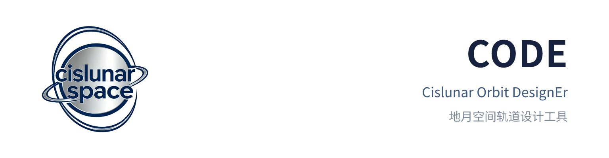

# CODE：Cislunar Orbit DesignEr（地月空间轨道设计 GUI）



[](https://github.com/cislunarspace/CODE/releases)
[](https://github.com/cislunarspace/CODE/actions/workflows/ci.yml)
[](https://cislunarspace.github.io/CODE/zh/)
[](https://www.python.org/)
[](LICENSE)

CODE（Cislunar Orbit DesignEr）是 [e2m2e](https://github.com/cislunarspace/CODE-core) 的 GUI 前端。e2m2e 提供地月空间轨道设计所需的动力学模型、修正器、延拓器与转移算法，本仓库把它们封装成可视化桌面应用：React 前端负责界面，Rust 壳负责进程编排，e2m2e 以 sidecar 子进程运行（stdio JSON 行 + 二进制帧协议）。界面不碰算法，算法不进界面。

## 安装

从 [GitHub Releases](https://github.com/cislunarspace/CODE/releases) 下载对应平台安装包：

- Windows x64：`CODE_<版本>_x64-setup.exe`（NSIS，免管理员，装到当前用户目录）或 `.msi`；
- Linux amd64 / aarch64：AppImage、`deb` 或 `rpm`。

安装包内含 e2m2e 运行时（sidecar）、AI 助手运行时（pi）与全套 SPICE 内核（含行星历），开箱即用；下载后可对照 `checksums.txt` 校验。已安装的应用自动接收应用内更新：AppImage 与 Windows 安装包由更新插件直接替换（更新包不含内核，首次安装的内核原地复用）；deb/rpm 在应用内下载完整安装包并经系统包管理器安装。

## 开发环境

需要 Python、Node.js 与 Rust 工具链，Linux 另需 Tauri 前置的 GTK 与 WebKit 开发库（见 [Tauri 前置条件](https://tauri.app/start/prerequisites/)），Python 依赖用 [uv](https://docs.astral.sh/uv/) 管理。

```bash
uv sync                             # Python 依赖
npm ci --prefix frontend            # 前端依赖
npx --prefix frontend tauri dev     # 开发模式启动
```

启动方式有两种，区别在算法侧从哪来：

- 开发模式 `npx --prefix frontend tauri dev`：起 Vite 开发服务器（`127.0.0.1:1430`）、以 debug 配置编译并运行 Rust 壳、Rust 壳再用 `uv run e2m2e serve-stdio` 在仓库根拉起 sidecar。算法走仓库源码，改 Python 不用打包。
- 打包模式：先产 sidecar 单文件 `uv run --no-sync pyinstaller packaging/cislunar_code_sidecar.spec --noconfirm`，把 `dist/cislunar-code-sidecar`（Windows 为 `.exe`）复制到 `src-tauri/binaries/`，再执行 `npm --prefix frontend exec -- tauri build --config packaging/tauri.release.conf.json`。这一档的 sidecar 取 `binaries/` 内的 PyInstaller 产物，与安装包一致。

开发期调试：

- 界面：改前端源码由 Vite 热更新即刻生效，不必重启。窗口内右键可开 devtools。界面只在桌面窗口里完整可用，纯浏览器打开 `127.0.0.1:1430` 发不出计算（Tauri IPC 不在）。
- Rust：`tauri dev` 监听 `src-tauri/`，改动后自动重编译并重启。
- Python：sidecar 是常驻子进程，改完代码要重启应用才生效。它的 stderr 直接打在 `tauri dev` 的终端，排障先看这里。
- 助手链路：开发期需要本机 pi（`TOD_PI_BIN` 指定或 PATH 里能找到），mcp-serve 同样由 `uv run e2m2e mcp-serve` 拉起。

## SPICE 内核

SPICE 内核经 Git LFS 随仓库分发（克隆后位于 `kernels/`），安装包也已随带；纯 CR3BP 工具用不到行星历。需另行准备的场景（精简环境、自备数据）：

- 自动下载：`uv run python scripts/download_kernels.py`（幂等拉取到 `kernels/`）；
- 手动下载：从 e2m2e 的 [`kernels-v1` release](https://github.com/cislunarspace/CODE-core/releases) 解压到 `kernels/`；
- 自备数据：`$SPICE_KERNEL_DIR` 指向已有内核目录（优先级最高）。

官方来源：[NASA NAIF](https://naif.jpl.nasa.gov/naif/data.html)（备用）。

## 快速开始

1. 左栏项目页签管理当前项目；轨道库页签自动加载全库，可按族类型、平动点、Jacobi 与振幅区间、标签组合过滤。
2. 中栏工具面板选择工具，参数表单按工具的 JSON Schema 自动生成，填好点执行。
3. 结果轨迹随即出现在右侧画布：拖拽旋转、滚轮缩放，适配按钮按轨迹包围盒复位视角；轨道库记录可钉入固定层，与结果层对照显示。
4. 右侧助手边栏在 pi 完成 provider 登录后可对话式发起计算（见“AI 助手”）。界面固定简体中文。

## 能力

- **工具面板**：轨道族生成、任务轨道设计、参数空间扫描、轨道保持、轨道预报、转移轨道设计、时空坐标转换、分区边界八个工具。表单按各工具的 JSON Schema 自动生成，执行前防呆校验（必填与数值范围，内联标红），错误直显。转移设计按转移类型联动显隐参数，LGA/WSB 提交时自动取选中轨道工件换算到会合系物理单位注入目标星历。轨道稳定性已随上游 e2m2e 5.9.8 移除（`e2m2e.algorithm.stability` 模块删除）。
- **轨道族生成**：八族（Halo / NRHO / Axial / Lissajous / SPO / LPO / Horseshoe / DRO）周期延拓与参数采样，成员轨迹逐条渲染。
- **轨道库**：产物自动入 e2m2e 轨道库（多维分类），可过滤查询、多选同屏绘制、写备注加星标；标注、族成员提升、导出包与删除入口齐备。
- **画布**：Three.js 3D 视图，结果层（当前计算产物）与固定层（钉住的库记录）双层。NASA 贴图天体（真实半径比例、晨昏线）、坐标轴与网格参照层、地月空间分区图层（Rosengren Primer 分区边界）；轨迹按 Jacobi 常数 coolwarm 着色，图例标注数据系（会合无量纲 / 会合物理 km / 地心惯性 km）；时间轴播放驱动画布时刻沿轨迹走查，机动事件以 chip 标注、点击跳转；图表设置持久化、webm 动画导出。
- **AI 助手（pi 会话运行时）**：右侧可折叠、可拖宽边栏。模型服务与 API key 由 pi 原生配置管理（BYOK，应用不收集不保存密钥；provider 登录在终端跑交互式 pi 完成，设置分区按钮直开终端）。会话与 agent loop 由随应用分发的固定版本 pi（RPC 协议）承载，工具经桥接扩展调 e2m2e 与宿主情景工具；工具调用分级确认——只读查询免确认直接执行，计算与改库先出工具卡片待批准或拒绝。会话跨重启恢复、多会话可切换续聊，输入区上方配置条直接切换模型与思考档（选项与 pi 原生配置同源）。助手触发的产物与手动运行语义一致：同一轨道库与画布叠加。开发期需本机 pi（`TOD_PI_BIN` 或 PATH）。

## 数据流与产物

参数表单 → Rust 命令 → e2m2e sidecar（JSON 行信封 + 二进制帧）→ 产物自动入轨道库 → 项目树与画布经 `catalog_query` / `get_artifact` 取用。AI 助手是并行的第二条链路：pi（RPC）→ 桥接扩展 → 应用 MCP 桥接 → `mcp-serve` 调同一套工具，与画布长计算互不阻塞。

轨道库 `catalog/` 位于用户配置目录（Windows `%APPDATA%/cislunar-code/catalog`，Linux 为 XDG 配置目录下同名路径），由 Rust 壳启动时显式指定，不随工作目录漂移，`E2M2E_CATALOG_DIR` 预设优先；库内是 e2m2e catalog 格式（多维分类、谱系指针），可直接被 e2m2e 或其他宿主打开。`output/` 仅保留转移遗留分区与脚本场景。

## 文档

在线文档：<https://cislunarspace.github.io/CODE/zh/>；本地构建：

```bash
uv sync --extra docs
uv run sphinx-build -b html -D language=zh docs/source docs/build/html
```

- [CONTEXT.md](CONTEXT.md)：领域术语表，代码与文档的用词以它为正典。
- [docs/architecture/architecture.md](docs/architecture/architecture.md)：分层与依赖规则。
- [CHANGELOG.md](CHANGELOG.md)：版本历史。

## 测试与代码规范

```bash
uv run pytest tests/ -m "not spice"                # Python 领域层
cargo test --manifest-path src-tauri/Cargo.toml    # Rust 壳与 sidecar 协议
npm --prefix frontend run test                     # 前端（vitest）
uv run ruff check . && uv run ruff format --check . && uv run pyright  # Python 静态检查（CI 同款）
```

无 Python 环境时 Rust 测试加 `-- --skip sidecar`。`assistant_pi_rpc` 用例依赖本仓库 uv 环境，须串行跑。

## 贡献

见 [CONTRIBUTING.md](CONTRIBUTING.md)。

## License

[Apache 2.0](LICENSE)
